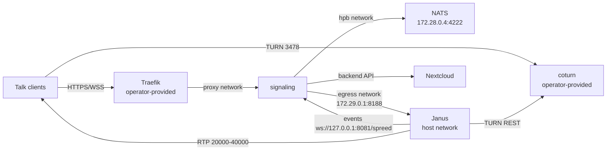

<!--
SPDX-FileCopyrightText: 2026 Travis Wichert

SPDX-License-Identifier: AGPL-3.0-or-later
-->

# Nextcloud Talk high-performance backend (HPB)

An Ansible role that deploys a [Nextcloud Talk high-performance backend](https://github.com/strukturag/nextcloud-spreed-signaling)
on a single node: the signaling server, the Janus MCU and the NATS message bus, all
from hardened images built by this repository.

The role installs three systemd-wrapped containers:

| Component | Image | Role |
| --- | --- | --- |
| `nextcloud-spreed-signaling` | `ghcr.io/littlecedar/ansible-role-nextcloud-talk-hpb-spreed:2.1.1` | Signaling server: the only public HTTP/WebSocket endpoint |
| Janus | `ghcr.io/littlecedar/ansible-role-nextcloud-talk-hpb:1.4.3` | MCU: VideoRoom, WebSocket transport, WebSocket event handler |
| NATS | `ghcr.io/littlecedar/ansible-role-nextcloud-talk-hpb-nats:2.15.1` | Message bus between the two |

The external TURN server (coturn) and the TLS reverse proxy (Traefik) are
operator-provided. **This role never deploys, packages or exposes either of them**:
it consumes their network, address and secret contract only.



## Requirements

- Linux with Docker and systemd on the target host.
- An external Docker network (`proxy` by default) that the operator creates before the
  playbook runs and that the operator's Traefik container is attached to.
- A TURN server using TURN REST credentials (`coturn --use-auth-secret` or equivalent),
  sharing `nextcloud_talk_hpb_turn_static_auth_secret`.
- A Nextcloud instance with the Talk app.

### Role dependencies

The role expects the MASH (Mother-of-All-Self-Hosting) playbook to provide two
roles and their variables. They are **not** declared in `meta/main.yml`, so the
role stays usable standalone:

- `com.devture.ansible.role.playbook_help` — `devture_playbook_help_container_retries_*`
- `com.devture.ansible.role.systemd_docker_base` — `devture_systemd_docker_base_*`
  (systemd path, Docker command, pull and network-creation methods, network driver
  options, stop grace time, cleanup timeouts)

The only Ansible collection required is `community.docker` (`docker_network`,
`docker_network_info`, `docker_image_pull`, `docker_image_build`).

## Using the role in the MASH playbook

`templates/requirements.yml`:

```yaml
- src: git+https://github.com/littlecedar/ansible-role-nextcloud-talk-hpb.git
  version: v1.4.3-0
  name: nextcloud_talk_hpb
  activation_prefix: nextcloud_talk_hpb_
```

`templates/setup.yml`: add `nextcloud_talk_hpb` after `nextcloud` (and after the
playbook's Traefik role, if used).

`templates/group_vars_mash_servers`, in a `# role-specific:nextcloud_talk_hpb` block:

```yaml
nextcloud_talk_hpb_enabled: false
nextcloud_talk_hpb_identifier: "{{ mash_playbook_service_identifier_prefix }}nextcloud-talk-hpb"
nextcloud_talk_hpb_base_path: "{{ mash_playbook_base_path }}/{{ mash_playbook_service_base_directory_name_prefix }}nextcloud-talk-hpb"
nextcloud_talk_hpb_uid: "{{ mash_playbook_uid }}"
nextcloud_talk_hpb_gid: "{{ mash_playbook_gid }}"
nextcloud_talk_hpb_nextcloud_url: "{{ nextcloud_scheme }}://{{ nextcloud_hostname }}{{ nextcloud_path_prefix }}"
# 64 bytes (sha256 hex) keeps the signaling hash key inside its recommended 32/64-byte range;
# the block key must be 16, 24 or 32 bytes or the signaling server refuses to start.
nextcloud_talk_hpb_signaling_hash_key: "{{ (mash_playbook_generic_secret_key + ':nextcloud-talk-hpb.hash') | hash('sha256') }}"
nextcloud_talk_hpb_signaling_block_key: "{{ ((mash_playbook_generic_secret_key + ':nextcloud-talk-hpb.block') | hash('sha256'))[:32] }}"
nextcloud_talk_hpb_signaling_internal_shared_secret_key: "{{ (mash_playbook_generic_secret_key + ':nextcloud-talk-hpb.internal') | hash('sha512') }}"
nextcloud_talk_hpb_nats_token: "{{ (mash_playbook_generic_secret_key + ':nextcloud-talk-hpb.nats') | hash('sha512') }}"
nextcloud_talk_hpb_proxy_network: proxy
nextcloud_talk_hpb_signaling_container_labels_traefik_enabled: "{{ traefik_enabled | default(false) }}"
nextcloud_talk_hpb_signaling_container_labels_traefik_docker_network: "{{ nextcloud_talk_hpb_proxy_network }}"
traefik_container_additional_networks_custom:
  - "{{ nextcloud_talk_hpb_proxy_network }}"
```

and add the three units to
`mash_playbook_devture_systemd_service_manager_services_list_auto_itemized`:

```yaml
  # role-specific:nextcloud_talk_hpb
  - |-
    {{ ({'name': (nextcloud_talk_hpb_nats_identifier + '.service'), 'priority': 2000, 'restart_necessary': (nextcloud_talk_hpb_restart_necessary | bool), 'groups': ['mash', 'nextcloud-talk-hpb']} if nextcloud_talk_hpb_enabled else omit) }}
  - |-
    {{ ({'name': (nextcloud_talk_hpb_signaling_identifier + '.service'), 'priority': 2001, 'restart_necessary': (nextcloud_talk_hpb_restart_necessary | bool), 'groups': ['mash', 'nextcloud-talk-hpb']} if nextcloud_talk_hpb_enabled else omit) }}
  - |-
    {{ ({'name': (nextcloud_talk_hpb_janus_identifier + '.service'), 'priority': 2002, 'restart_necessary': (nextcloud_talk_hpb_restart_necessary | bool), 'groups': ['mash', 'nextcloud-talk-hpb']} if nextcloud_talk_hpb_enabled else omit) }}
  # /role-specific:nextcloud_talk_hpb
```

The operator then supplies `nextcloud_talk_hpb_hostname`, `nextcloud_talk_hpb_public_ip`,
`nextcloud_talk_hpb_turn_static_auth_secret` and `nextcloud_talk_hpb_signaling_secret`,
and sets `nextcloud_talk_hpb_enabled: true`.

See [`docs/configuring-nextcloud-talk-hpb.md`](docs/configuring-nextcloud-talk-hpb.md)
for the required variables, image overrides, the Traefik/coturn/Nextcloud contract and
the post-deployment steps.

## Networks

The role owns only its internal networks; the proxy network is the operator's.

| Network | Type | Default | Purpose |
| --- | --- | --- | --- |
| `nextcloud-talk-hpb-hpb` | internal bridge, `172.28.0.0/24` | created by the role | signaling ↔ NATS, no host route |
| `nextcloud-talk-hpb-egress` | bridge, `172.29.0.0/24`, gateway `172.29.0.1` | created by the role | signaling ↔ host-networking Janus |
| `proxy` | external | created by the operator | Traefik → signaling |

## Ports

| Port | Scope | Service |
| --- | --- | --- |
| `443` | public | operator's Traefik (WebSocket upgrade for `/spreed`) |
| `20000-40000/udp` | public | Janus RTP/RTCP |
| `3478/tcp+udp` and the relay range | public | operator's coturn |
| `127.0.0.1:8081` | loopback | signaling HTTP; also the Janus event handler target |
| `127.0.0.1:8088` | loopback | Janus HTTP API |
| `172.29.0.1:8188` | egress subnet | Janus WebSocket transport |
| `4222` | hpb network only | NATS |

`8081`, `8088` and `8188` must be dropped by the host firewall on public interfaces.

## Operating

```sh
journalctl -u nextcloud-talk-hpb-nats -f
journalctl -u nextcloud-talk-hpb-signaling -f
journalctl -u nextcloud-talk-hpb-janus -f
```

Containers log through systemd only (`--log-driver=none`). Setting
`nextcloud_talk_hpb_enabled: false` and re-running the playbook stops and removes
the units, the role's two networks and the base path. The external proxy network
is never removed, even with `nextcloud_talk_hpb_proxy_network_deletion_enabled: true`.

## Container images

All three defaults are consumed from GHCR; this repository builds and publishes them.
GHCR packages are private unless you make them public, and the role pulls anonymously:
either make all three packages public, or authenticate the target Docker daemon with a
token that has `read:packages`. Only Janus supports a target-side self-build. NATS and
Spreed are used either from the published images or from images you build locally and
point the role at with
`nextcloud_talk_hpb_nats_container_image` or `nextcloud_talk_hpb_signaling_container_image`
plus the matching `*_container_image_pull: false`.

| Service | Build context | Default image | Pinned version |
| --- | --- | --- | --- |
| Janus | [`build/janus/`](build/janus) | `ghcr.io/littlecedar/ansible-role-nextcloud-talk-hpb:1.4.3` | Janus `1.4.3` (`1f0b75ca`) |
| NATS | [`build/nats/`](build/nats) | `ghcr.io/littlecedar/ansible-role-nextcloud-talk-hpb-nats:2.15.1` | NATS `2.15.1` (`b2fd3efc`) |
| Spreed signaling | [`build/spreed/`](build/spreed) | `ghcr.io/littlecedar/ansible-role-nextcloud-talk-hpb-spreed:2.1.1` | Spreed `2.1.1` (`e7a8fb7a`) |

Only Janus can be built on the target: set
`nextcloud_talk_hpb_janus_container_image_self_build: true` and the role clones this
repository and builds `build/janus` inside the instance. NATS and Spreed have no
self-build path; build them locally and set the matching `*_container_image_pull: false`.
The molecule-only test client image lives in [`build/test-client/`](build/test-client).

```sh
docker build -t ansible-role-nextcloud-talk-hpb:local build/janus
docker build -t nextcloud-talk-hpb-nats:local build/nats
docker build -t nextcloud-talk-hpb-spreed:local build/spreed

./scripts/smoke-test-janus.sh ansible-role-nextcloud-talk-hpb:local
./scripts/smoke-test-nats.sh nextcloud-talk-hpb-nats:local
./scripts/smoke-test-spreed.sh nextcloud-talk-hpb-spreed:local
```

To run locally built NATS or Spreed images, point
`nextcloud_talk_hpb_signaling_container_image` or `nextcloud_talk_hpb_nats_container_image`
at them and set the matching `*_container_image_pull: false`.

Janus pins: Ubuntu 24.04 base, Janus `1.4.3` (`1f0b75ca`), libnice `0.1.24`, libsrtp
`2.8.1`, libwebsockets `4.3.10`, usrsctp `c625e219`. Dependency versions are comments
next to their commit ARGs; bump them by changing the commit, since an unused version
ARG would be a misleading knob. Janus releases are picked up weekly by
`update-janus.sh`, which moves the `build/janus/Dockerfile` pins, the image tag and the
self-build release tag together.

NATS and Spreed build from pinned upstream tags. Their Dockerfiles record both the
version and the commit and fail the build if the tag no longer points at that commit.
To upgrade either service, bump the version and commit in its Dockerfile, update the
matching `nextcloud_talk_hpb_*_container_image_tag` in `defaults/main.yml`, and update
the pin tables in this README and the configuration guide; the publish workflow then
builds the new tags.

Data channels (`usrsctp`) are enabled because the Nextcloud Talk signaling server
refuses an MCU without them (`Could not create janus MCU: data channels are not
supported`).

Janus hardening: non-root UID/GID `10001`, read-only root, all capabilities dropped,
`no-new-privileges`, no compiler or `-dev` package in the runtime, VideoRoom only,
no recordings and no post-processing, both Janus admin transports disabled,
TURN REST credentials generated into a mode-`600` tmpfs file with the secret unset
before `exec`. The Janus image supports configuration overrides from `/etc/janus.d`;
the role does not mount that directory, so an override must be mounted separately. See
[`conf.d/README.md`](conf.d/README.md) for the override format and mounting requirement.

NATS and Spreed hardening: non-root (the images default to UID/GID `1000`; the role
runs them as `nextcloud_talk_hpb_uid`/`gid`), read-only root, all capabilities dropped,
`no-new-privileges`, and a shell-free `scratch` runtime. The signaling configuration is
rendered by Ansible and mounted read-only; `SIGUSR1` provides graceful shutdown.

Image pipeline: `.github/workflows/ci.yml` runs on pull requests, builds and smoke-tests
all three images, and runs molecule. `.github/workflows/publish.yml` runs on pushes to
`main` and on `workflow_dispatch`: it builds and smoke-tests all three images, runs
molecule, and only then pushes tags — `sha-<short>` for every publish run, plus `edge`,
`latest` and the service version when the ref is `main`. No other workflow pushes
images. Role releases (`v1.4.3-0`) are separate tags and never publish an image.

## Development

```sh
yamllint .
ansible-lint
shellcheck scripts/*.sh build/janus/docker-entrypoint.sh
ansible-galaxy role install -r molecule/default/requirements.yml   # once
ansible-galaxy collection install community.docker ansible.posix  # once
molecule test          # nested Docker inside a privileged VM-like container
```

`molecule test` prepares the NATS, Spreed and test-client images in
`molecule/default/prepare.yml`, stages the Janus source as a tagged repository so the
role's self-build path builds it inside the instance, then converges the role, starts
the three units, runs the HPB protocol client against the signaling server and asserts
the security and configuration invariants in `molecule/verify_tasks.yml`.

## License

AGPL-3.0-or-later. See [`LICENSE`](LICENSE).
